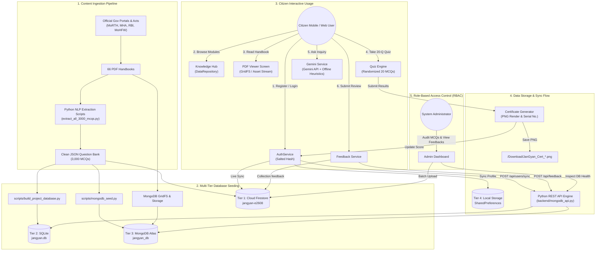

# JanGyan (जनज्ञान) – Complete Project Master Documentation
**Official Project Details, Architecture, Complete Tech Stack, 5 Team Roles & End-to-End Data Lifecycle**

---

## 🏛️ 1. Executive Summary & Project Overview

### 1.1 Project Introduction & Official Mission
**JanGyan** (*"Learn Without Limits" 🇮🇳*) is a production-grade, multi-platform civic literacy and e-learning ecosystem designed specifically for the citizens of India. 

In India, a vast majority of citizens encounter daily challenges regarding:
- **Cyber Frauds & Digital Scams**: Phishing, OTP thefts, fake investment schemes, and lack of knowledge about the National Cyber Crime Reporting Portal & **Helpline 1930**.
- **Public Governance & Citizen Rights**: Unawareness of the **Right to Information (RTI) Act 2005**, DigiLocker legal validity (Rule 9A of IT Rules 2016), UMANG services, and CPGRAMS grievance redressal.
- **Road Safety & Trauma Care**: Lack of knowledge regarding the **Motor Vehicles (Amendment) Act 2019**, the **Good Samaritan Protection (Section 134A)**, and the **Golden Hour** life-saving protocol.
- **Healthcare & Emergency Access**: Insufficient awareness of **Ayushman Bharat (PM-JAY)**, hands-only CPR, and unified emergency response services (**112** and **108**).
- **Financial Literacy & Digital Finance**: Misunderstanding UPI mechanisms (e.g. entering UPI PIN receives money vs sends money), RBI Ombudsman scheme, and PMJDY benefits.
- **Civic & Environmental Responsibility**: Mission LiFE guidelines, municipal Solid Waste Management Rules, E-Waste handling, and rooftop solar subsidies.

**JanGyan bridges this massive information gap** by transforming verified government curricula, official handbooks, and statutory provisions into an intuitive, gamified, and universally accessible mobile application and web portal.

```
+-----------------------------------------------------------------------------------+
|                                 JANGYAN ECOSYSTEM                                 |
+-----------------------------------------------------------------------------------+
|  📱 FLUTTER MOBILE APP (Android APK)  |  🌐 STANDALONE WEB PORTAL (HTML/CSS/JS)   |
+-----------------------------------------------------------------------------------+
|                      6 CRITICAL CIVIC DOMAINS (500 MCQs EACH)                     |
|            66 OFFICIAL HANDBOOKS  |  3,000 AUTHENTIC EXAM-GRADE MCQs              |
+-----------------------------------------------------------------------------------+
|  🤖 GEMINI CIVIC AI ASSISTANT        |  📜 VERIFIED CITIZEN CERTIFICATE ENGINE   |
+-----------------------------------------------------------------------------------+
|                   RESILIENT MULTI-TIER HYBRID DATA ARCHITECTURE                   |
|  Tier 1: Firebase Firestore  | Tier 2: SQLite  | Tier 3: MongoDB | Tier 4: Cache  |
+-----------------------------------------------------------------------------------+
```

---

### 1.2 The 6 Civic Knowledge Domains

Every domain is mapped to 10 structured learning modules (modular PDF handbooks) plus 1 comprehensive examination handbook, backed by 500 verified MCQs per category:

| # | Domain Title | Key Topics Covered | Handbooks | Verified MCQs |
|---|---|---|:---:|:---:|
| **1** | **Cyber Safety & Digital Security** | 1930 Cyber Fraud Helpline, Phishing, OTP security, DPDP Act 2023, 2FA, Social Engineering, Ransomware prevention | 10 Modules + 1 Exam PDF | **500** |
| **2** | **Government Services & Citizen Rights** | Constitution of India, RTI Act 2005, DigiLocker legal standing, UMANG, Aadhaar security, CPGRAMS, Fundamental Duties | 10 Modules + 1 Exam PDF | **500** |
| **3** | **Road Safety & Public Safety** | Motor Vehicles Act 2019, Good Samaritan Law (Sec 134A), Golden Hour, Cashless Treatment Scheme 2025, Helmet standards | 10 Modules + 1 Exam PDF | **500** |
| **4** | **Health & Emergency Awareness** | Unified Emergency 112, Hands-Only CPR, Ayushman Bharat PM-JAY, Non-Communicable Diseases (NCDs), First Aid | 10 Modules + 1 Exam PDF | **500** |
| **5** | **Financial Literacy & Digital Finance** | Safe UPI PIN usage, NPCI guidelines, RBI Ombudsman, PMJDY, Compound Interest, Credit Score (CIBIL), Ponzi scheme warning | 10 Modules + 1 Exam PDF | **500** |
| **6** | **Environment & Civic Responsibility** | Mission LiFE, Solid Waste Management Rules 2016, E-Waste segregation, Rooftop Solar (PM Surya Ghar), Water Conservation | 10 Modules + 1 Exam PDF | **500** |
| **TOTAL** | **6 Civic Domains** | **National Official Guidelines & Curricula** | **66 Handbooks** | **3,000 MCQs** |

---

### 1.3 Key Functional Capabilities
1. **Interactive 20-Question Randomized Assessment Engine**: Generates balanced 20-question tests with real-time countdown timer, dynamic question progress telemetry, instant feedback, and detailed answer review.
2. **Dynamic Assessment Modes**:
   - *Standard Mode*: 20 questions with balanced difficulty and scoring.
   - *Timed Exam*: Strict countdown simulation with automatic submission upon time expiry.
   - *Practice / Study Mode*: Immediate explanation and correction upon answering each question.
3. **Official Citizen Certificate Generator**: Renders a high-resolution, branded JanGyan certificate (`RepaintBoundary`) with unique verification serial number, citizen name, score percentage, and QR signature. Citizens can download directly to device storage or share via social media.
4. **In-App Watermarked Handbook Viewer**: PDF reader displaying official state and central curricula with citizen email watermark overlay for intellectual integrity.
5. **Real-Time Gemini AI Civic Assistant**: Powered by Google Gemini (`gemini-3.5-flash`), pre-prompted with Indian civic knowledge. Features a built-in **Offline Rule-Based Civic Knowledge Fallback Engine** ensuring 100% responsiveness even without internet or API keys.
6. **Citizen Profile & Badge System**: Tracks attempted questions, accuracy percentage, quiz history, and awards progressive proficiency badges (*Civic Scholar*, *Constitution Master*, *Cyber Defender*).
7. **Citizen Feedback System**: Enables citizens to submit ratings and feedback, automatically synced across Firebase Firestore, SQLite, and MongoDB, and logged for administrative response.
8. **Administrative Portal**: Complete dashboard for verifying question bank integrity, inspecting database synchronization, reviewing citizen feedback, and batch-uploading data to cloud Firestore.
9. **Emergency Helpline Carousel**: Direct access to national emergency lines: **112** (National Emergency), **1930** (Cyber Fraud), **108** (Medical Ambulance), **1098** (Childline), and **181** (Women Helpline).

---

## 🛠️ 2. In-Depth Tech Stack Used Across JanGyan

Every single technology, library, framework, and utility used in the project is cataloged below:

### 2.1 Mobile Application Frontend (Flutter / Dart)
- **Framework & Language**:
  - **Flutter SDK**: `v3.47.7` (Channel Stable)
  - **Dart SDK**: `v3.13.5` with **Sound Null Safety**
  - **Target Platforms**: Android (Release APK built: `JanGyan.apk`), Web, Windows, iOS ready.
- **Design System & UI**:
  - **Material Design 3 (M3)** with custom theme tokens.
  - **Google Fonts (`google_fonts: ^6.2.1`)**: Embedded typography using *Plus Jakarta Sans* and *Inter*.
  - **Cupertino Icons (`cupertino_icons: ^1.0.8`)**: iOS style glyphs alongside Material icons.
  - **Custom Color Palette (`app_colors.dart`)**: Civic Blue (`#0D47A1`), Ocean Blue (`#1565C0`), Pure White (`#FFFFFF`), Soft Slate (`#F8FAFD`), Success Emerald (`#2E7D32`), Error Ruby (`#D32F2F`), Warning Amber (`#ED6C02`).
- **State Management & Architecture**:
  - **Provider (`provider: ^6.1.5+1`)**: Reactive state management with `ChangeNotifier` (`AuthService`, `DataRepository`, `GeminiService`).
  - **Clean Service Architecture**: Strict separation of UI screens, widgets, models, services, and core configurations.
- **Persistence & Local Hardware APIs**:
  - **`shared_preferences: ^2.5.6`**: Fast local key-value store for session restoration, user statistics, Gemini API keys, and offline quiz history.
  - **`path_provider: ^2.1.6`**: Resolves local device directories (`/storage/emulated/0/Download`, Application Documents).
  - **`image_picker: ^1.1.2`**: Native camera and gallery photo picking for citizen avatars.
  - **`share_plus: ^10.1.4`**: Native Android share sheet integration for certificates and scorecards.
- **Networking & Cloud Services**:
  - **`http: ^1.6.0`**: REST API consumption for Python backend and Google Gemini API.
  - **`url_launcher: ^6.3.1`**: Deep-linking for external portals, tel links (112, 1930), and web downloads.
  - **`firebase_core: ^5.0.0`**: Core Firebase SDK initialization with graceful fallback.
  - **`firebase_auth: ^7.0.0`**: Cloud authentication engine.
  - **`cloud_firestore: ^7.0.0`**: Real-time cloud database syncing.
  - **`firebase_storage: ^14.0.0`**: Cloud asset storage for PDFs and citizen avatars.
  - **`google_sign_in: ^6.2.2`**: OAuth 2.0 Google single sign-on.
- **PDF & Document Rendering**:
  - **`flutter_pdfview: ^1.4.5`**: Native hardware-accelerated PDF canvas rendering.
- **Utilities & Cryptography**:
  - **`uuid: ^4.6.0`**: Cryptographic RFC4122 v4 UUID generation for sessions, certificates, and attempts.
  - **`intl: ^0.20.3`**: Date and time formatting, localized numeral formatting.
  - **Custom Deterministic Hashing**: Cross-platform salted password hashing (`jangyan_secure_salt_` with 31-bit DJB2 algorithm) preventing plaintext storage in offline mode.

---

### 2.2 Standalone Web Portal Frontend (`website/`)
- **Structure**: Semantic **HTML5** with accessibility standards (`aria-label`, landmarks, schema meta tags).
- **Styling**: **Vanilla CSS3** (`style.css` - 37.6 KB) featuring:
  - Custom Design Tokens (CSS Variables: `--primary`, `--primary-dark`, `--accent`, `--bg-light`, `--surface`, `--text-dark`).
  - Glassmorphic card styling (`backdrop-filter: blur(12px)`).
  - Responsive layout engines (**CSS Grid** & **Flexbox**).
  - Dark / Light mode toggle with CSS root variable reassignment.
  - Keyframe micro-animations for pulse effects, badges, and progress bars.
- **Logic & Interactions**: **Vanilla JavaScript (ES6+)** (`script.js` - 33.5 KB):
  - Dynamic Handbook search and modal viewer.
  - Full-length 500-MCQ and 20-MCQ Interactive Assessment Simulator.
  - HTML5 Canvas dynamic Certificate generator.
  - Web Audio API integration for authentic feedback sounds.
  - LocalStorage caching for user progress and dark mode preferences.
- **Assets & Icons**:
  - **FontAwesome 6 Pro CDN** for over 40 bespoke civic icons.
  - Embedded questions database (`questions.js` - 2.1 MB) enabling instant zero-latency quiz launches.

---

### 2.3 Backend API Service (`backend/`)
- **Technology**: **Python 3** native asynchronous multi-threaded HTTP server.
- **Engine**: `http.server.ThreadingHTTPServer` (`ReusableServer` with daemon threads and address reuse).
- **Zero-Dependency Core**: Can run out-of-the-box on standard Python 3 installations, with optional plug-and-play drivers for MongoDB.
- **Key Modules**:
  - `pymongo` & `gridfs`: Driver for MongoDB Atlas connection, document querying, and GridFS chunked streaming.
  - `sqlite3`: Native relational query engine accessing `database/jangyan.db`.
  - `urllib.parse`: URL parsing, query string extraction, and path decoding.
  - `json` & `os`: JSON serialization and file system management.
- **REST API Endpoints**:
  - `GET  /api/health` — Complete status check of Firebase, SQLite, MongoDB Atlas, GridFS count, and total MCQs.
  - `GET  /api/categories` — Retrieves all 6 civic domain definitions and statistics.
  - `GET  /api/questions?category=<id>&count=<n>` — Returns randomized questions for assessment.
  - `GET  /api/pdf/<filename>` — Streams PDF handbooks via GridFS with byte-range requests and local fallback.
  - `GET  /api/users/<email>` — Retrieves citizen profile, attempt counts, and scores.
  - `POST /api/users/sync` — Synchronizes user profile across MongoDB, SQLite, and JSON dumps.
  - `POST /api/feedback` — Registers citizen feedback and logs dispatch to `jangyan.admin@gmail.com`.
  - `GET  /api/handbooks` — Lists all 66 registered handbooks with byte sizes and download links.

---

### 2.4 Multi-Tier Database Architecture

JanGyan does not rely on a single point of failure. It implements a **4-Tier Resilient Storage Hierarchy**:

```
+-----------------------------------------------------------------------------------+
|                        TIER 1: FIREBASE CLOUD FIRESTORE                           |
|  - Cloud hosted at 'asia-south1' (Mumbai)                                         |
|  - Real-time NoSQL collections: users, quizProgress, feedback, categories        |
|  - Rule-based access control via firestore.rules                                  |
+-----------------------------------------------------------------------------------+
                                      ▲
                                      │ (Real-time Cloud Sync)
+-----------------------------------------------------------------------------------+
|                       TIER 2: PROJECT SQLITE RELATIONAL DB                        |
|  - File: 'database/jangyan.db' (1.73 MB, WAL Mode Enabled)                        |
|  - 6 Normalized Tables: categories, handbooks, questions, users,                  |
|    quiz_progress, feedback                                                        |
+-----------------------------------------------------------------------------------+
                                      ▲
                                      │ (API Dispatch & Backup)
+-----------------------------------------------------------------------------------+
|                     TIER 3: MONGODB ATLAS & GRIDFS BLOB STORE                     |
|  - Cloud Cluster / Local MongoDB: 'jangyan_db' via MONGODB_URI                    |
|  - GridFS: Binary chunked storage for all 66 PDF handbooks (fs.files, fs.chunks)  |
|  - JSON Dumps: 'database/mongodb_dump/' (categories, questions, users, feedback)  |
+-----------------------------------------------------------------------------------+
                                      ▲
                                      │ (Offline-First Fallback)
+-----------------------------------------------------------------------------------+
|                     TIER 4: LOCAL CLIENT PERSISTENCE ENGINE                       |
|  - Mobile: SharedPreferences + Application Sandbox Documents                      |
|  - Web: browser LocalStorage + Embedded JSON question assets                      |
+-----------------------------------------------------------------------------------+
```

---

### 2.5 AI & Intelligent Services
- **Google Gemini AI Engine**:
  - Model: `gemini-3.5-flash` with automatic fallback to `gemini-flash-latest` and `gemini-flash-lite-latest`.
  - Role: Answers civic inquiries, decodes legal provisions (e.g. RTI filing steps, Good Samaritan protections, Ayushman eligibility).
- **Rule-Based Civic Knowledge Fallback Engine**:
  - Hardcoded heuristic pattern-matching engine embedded inside `gemini_service.dart`.
  - Instantly detects keywords like `1930`, `112`, `fir`, `digilocker`, `cpr`, `ayushman`, `upi`, `rti`, `om budsman` and provides accurate, official guidance when offline.

---

### 2.6 Data Extraction & Preparation Scripts (`scripts/`)
- `scripts/build_project_database.py`: Constructs the normalized relational SQLite database (`jangyan.db`) from JSON assets and enables WAL mode.
- `scripts/extract_all_3000_mcqs.py` & `extract_mcqs.py`: Regex-based natural language parsing scripts that extract questions, 4 options, correct answer keys, and explanations from curriculum documents.
- `scripts/mongodb_seed.py`: Connects to MongoDB Atlas, uploads 66 handbooks into GridFS, and indexes all 3,000 questions.
- `scripts/generate_modules_metadata.py` & `save_definitive_metadata.py`: Automatically indexes handbook files, page counts, byte sizes, and category associations.
- `scripts/clean_mcq_glitch.py` & `shuffle_mcqs.py`: Ensures zero formatting glitches, strips corrupt tokens, and validates MCQ answer uniqueness.

---

### 2.7 DevOps, CI/CD & Build Infrastructure
- **Continuous Integration / Continuous Deployment (CI/CD)**:
  - **GitHub Actions (`.github/workflows/deploy.yml`)**: Automatically triggers on pushes to `main`. Sets up Java JDK 17, compiles Flutter Web release bundle (`flutter build web --release --base-href "/jangyan-app/"`), and deploys directly to **GitHub Pages**.
- **Android Build Automation**:
  - Gradle 8+ with Android Gradle Plugin (AGP).
  - Proguard / R8 optimization rules for Flutter release build.
  - High-performance signed release artifact: `JanGyan.apk` (274 MB with embedded offline PDFs and question banks).
- **Security Rules**:
  - `firestore.rules`: Document-level access control.
  - `storage.rules`: Admin-only PDF upload permissions, public read for learning handbooks, UID-bound user avatar uploads.

---

## 👥 3. The 5 Team Roles & Detailed Responsibilities

To achieve a production-ready system of this magnitude, the work was structured across **5 specialized roles**. Below is the exhaustive breakdown of each role, their exact ownership, day-to-day deliverables, and tech stack.

```
+----------------------------------------------------------------------------------------+
|                                   PROJECT TEAM ROLES                                   |
+----------------------------------------------------------------------------------------+
|  1. PROJECT LEAD            — Architecture, Roadmaps, Release & Security Oversight     |
|  2. FRONTEND DEVELOPER      — Flutter Mobile (15 Screens), UI/UX & Web Portal          |
|  3. BACKEND DEVELOPER       — Python REST Server, API Routing, Gemini AI & Auth Logic  |
|  4. DATABASE HANDLER        — Multi-Tier Architecture (Firestore, SQLite, MongoDB)   |
|  5. RESEARCH & ANALYSIS     — Civic Curriculum, 3,000 MCQs, Handbooks & Extraction     |
+----------------------------------------------------------------------------------------+
```

---

### 👑 Role 1: Project Lead (Architecture, Coordination & Release Management)
- **Primary Objective**: Architect the complete end-to-end JanGyan ecosystem, align technical decisions with the national civic mission, manage sprint timelines, and guarantee production deployment quality.
- **Key Responsibilities**:
  1. **System Architecture Design**: Designed the **Dual-Client** (Flutter Mobile + Standalone Web Portal) and **Multi-Tier Resilient Backend** strategy to guarantee zero downtime even during total network failure.
  2. **Security & Governance Definition**: Formulated the security rules in `firestore.rules` and `storage.rules`. Designed the Role-Based Access Control (RBAC) model distinguishing Guest Citizens, Registered Citizens, and System Administrators.
  3. **DevOps & Release Pipeline**: Built and maintained `.github/workflows/deploy.yml` for automated GitHub Pages continuous deployment. Configured Android build flavors, release key signing, and produced the final `JanGyan.apk`.
  4. **Cross-Functional Sprint Leadership**: Coordinated between Frontend, Backend, Database, and Research handlers to ensure syllabus integrity, JSON schema uniformity, and API contract compliance.
  5. **Quality Assurance & Verification**: Performed end-to-end regression testing across authentication flows, offline modes, PDF rendering, certificate generation, and emergency helpline routing.
- **Files & Modules Owned**:
  - `README.md`, `PROJECT_DETAILS.md`
  - `.github/workflows/deploy.yml`
  - `firestore.rules`, `storage.rules`, `firebase.json`, `.firebaserc`
  - `android/app/build.gradle`, `analysis_options.yaml`
- **Core Tools & Technologies**:
  - Git & GitHub, GitHub Actions CI/CD, Flutter CLI, Android SDK / Gradle, Firebase Console.

---

### 🎨 Role 2: Frontend Developer (Flutter Mobile & Web Portal Specialist)
- **Primary Objective**: Craft a stunning, accessible, high-performance user interface across both the mobile application (Flutter) and the public web portal (HTML5/CSS3/JS), following Material Design 3 guidelines.
- **Key Responsibilities**:
  1. **15 Mobile Screens Development (Flutter)**:
     - `splash_screen.dart`: Animated civic branding, automatic session restoration from `SharedPreferences`.
     - `login_screen.dart`, `register_screen.dart`, `forgot_password_screen.dart`: Input validation, password visibility toggling, error alerts, and demo mode bypass.
     - `home_screen.dart`: National emergency carousel (112, 1930, 108), overall civic score cards, category progress indicators, and quick quiz launcher.
     - `category_selection_screen.dart` & `knowledge_hub_screen.dart`: Category cards with custom color themes, module progress badges, and reading status tracking.
     - `pdf_viewer_screen.dart`: Document rendering with dynamic citizen watermark overlay, page jump, and zoom controls.
     - `quiz_screen.dart`: High-performance exam engine with real-time timer, option selection animation, question jump palette, and unattempted question warning.
     - `quiz_results_screen.dart`: Score ring animations, accuracy percentage, time taken telemetry, full question-by-question review, and certificate generation.
     - `ai_assistant_screen.dart`: Chat interface for Gemini AI with auto-scrolling message bubbles, quick prompt chips, and loading indicators.
     - `feedback_screen.dart`: Interactive star rating, category selector, feedback submission form with instant validation.
     - `profile_screen.dart`: Avatar image picker, citizen statistics, earned badges display, and secure logout.
     - `admin_screen.dart`: Administrative control center for question bank inspection and manual cloud synchronization.
     - `guide_screen.dart`: In-app civic literacy manual and FAQs.
  2. **Custom Reusable Widgets**:
     - `assessment_mode_dialog.dart`: Modal for selecting Standard, Timed, or Practice assessment modes.
     - `citizen_avatar.dart`: Gradient avatar with fallback initials or camera photo uploads.
     - `helpline_banner.dart`: Click-to-call emergency helpline cards.
  3. **Certificate Generation Engine**: Implemented `CertificateSaver` and `RepaintBoundary` canvas rendering that converts the citizen's score into a verified PNG certificate with custom border, serial number, and emblem.
  4. **Standalone Web Portal (`website/`)**: Engineered `index.html`, `style.css`, and `script.js` featuring glassmorphism, responsive navigation drawer, dark/light theme switcher, and embedded quiz simulator.
- **Files & Modules Owned**:
  - All files in `lib/screens/` (15 files)
  - All files in `lib/widgets/`
  - `lib/core/app_colors.dart`, `lib/core/app_theme.dart`
  - `website/index.html`, `website/style.css`, `website/script.js`
- **Core Tools & Technologies**:
  - Flutter 3.47, Dart 3.13, Material Design 3, Google Fonts, HTML5, CSS3, ES6 JavaScript, Canvas API.

---

### ⚙️ Role 3: Backend Developer (API, Services & AI Integration Specialist)
- **Primary Objective**: Build a robust, lightweight, asynchronous Python REST API server, manage real-time and offline authentication, implement the Google Gemini AI integration, and handle dynamic document streaming.
- **Key Responsibilities**:
  1. **Python Multi-Threaded REST Service (`backend/mongodb_api.py`)**:
     - Developed a zero-external-dependency HTTP server utilizing `http.server.ThreadingHTTPServer`.
     - Built comprehensive request dispatchers for `/api/health`, `/api/categories`, `/api/questions`, `/api/pdf/<filename>`, `/api/users/sync`, and `/api/feedback`.
     - Integrated full **CORS Header** support (`Access-Control-Allow-Origin: *`) allowing seamless communication with Flutter Web and mobile clients.
     - Handled HTTP Range requests for streaming large PDF handbooks directly to mobile devices without memory exhaustion.
  2. **Authentication & Session Engine (`lib/services/auth_service.dart`)**:
     - Created a deterministic salted hashing mechanism (`hashPassword()`) using custom 31-bit DJB2 hashing with salt (`jangyan_secure_salt_`).
     - Engineered dual-mode authentication: verifies credentials locally from `SharedPreferences`, syncs to MongoDB via `/api/users/sync`, and updates Firebase Cloud Firestore.
     - Integrated Google Sign-In (`google_sign_in: ^6.2.2`) and Firebase Auth.
  3. **Google Gemini AI Integration (`lib/services/gemini_service.dart`)**:
     - Built direct REST client communicating with Google Gemini generative models (`gemini-3.5-flash`).
     - Designed civic system prompts restricting the AI to Indian constitutional, legal, and emergency topics.
     - Developed the **Offline Civic Knowledge Engine** with heuristic regex and keyword matchers for 1930, 112, DigiLocker, Good Samaritan Law, Ayushman Bharat, and UPI, guaranteeing instant offline replies.
  4. **Administrative Feedback Dispatcher**:
     - Structured `/api/feedback` to log citizen reviews into MongoDB, append to SQLite, and simulate dispatch to `jangyan.admin@gmail.com`.
- **Files & Modules Owned**:
  - `backend/mongodb_api.py`
  - `lib/services/auth_service.dart`
  - `lib/services/gemini_service.dart`
  - `lib/services/mongodb_service.dart`
  - `lib/services/firebase_service.dart`
  - `lib/core/app_config.dart`, `lib/core/app_secrets.dart`
- **Core Tools & Technologies**:
  - Python 3, ThreadingHTTPServer, REST architecture, Google Gemini API, Firebase Auth SDK, Google Sign-In SDK.

---

### 🗄️ Role 4: Database Handler (Data Architect & Multi-Tier DB Administrator)
- **Primary Objective**: Architect, normalize, maintain, and optimize all data tiers—Firebase Cloud Firestore, Relational SQLite, and MongoDB Atlas/GridFS—ensuring zero data loss, high concurrency, and complete data consistency.
- **Key Responsibilities**:
  1. **Relational SQLite Database Architecture (`database/jangyan.db`)**:
     - Created and optimized the 1.73 MB embedded SQLite database.
     - Designed 6 relational schemas with primary keys, foreign keys, and indices:
       - `categories`: Metadata for 6 domains.
       - `handbooks`: 66 handbooks with byte sizes and stream URLs.
       - `questions`: 3,000 MCQs linked by `category_id`.
       - `users`: Citizen credentials, hashed passwords, attempt stats, and admin flags.
       - `quiz_progress`: Historical exam scores, timestamps, and percentages.
       - `feedback`: Citizen reviews, star ratings, and categories.
     - Enabled **Write-Ahead Logging (WAL mode)** via `PRAGMA journal_mode=WAL;` to enable high-concurrency simultaneous reads and writes.
  2. **MongoDB Atlas & GridFS Document Store**:
     - Configured MongoDB Atlas cloud connection via `MONGODB_URI`.
     - Seeded all 66 PDF handbooks as binary chunks into **GridFS** (`fs.files`, `fs.chunks`).
     - Maintained JSON dumps in `database/mongodb_dump/` (`categories.json`, `questions.json`, `pdf_handbooks_metadata.json`, `users.json`, `feedbacks.json`).
  3. **Firebase Cloud Firestore Administration**:
     - Configured Firestore project `jangyan-e2608` in Mumbai (`asia-south1`).
     - Created batch upload scripts in `data_repository.dart` for cloud data sync.
     - Maintained collection schemas (`users`, `quizProgress`, `feedback`, `categories`, `questions`).
  4. **Database Automation & Build Scripts**:
     - Developed `scripts/build_project_database.py` to compile raw JSON dumps into the SQLite file.
     - Developed `scripts/mongodb_seed.py` for cloud cluster seeding and binary asset uploading.
- **Files & Modules Owned**:
  - `database/jangyan.db`
  - `database/README.md`
  - All files in `database/mongodb_dump/`
  - `scripts/build_project_database.py`
  - `scripts/mongodb_seed.py`
  - `lib/services/data_repository.dart`
- **Core Tools & Technologies**:
  - SQLite3, MongoDB Atlas, GridFS, Firebase Firestore, PyMongo, JSON Schema Design.

---

### 🔬 Role 5: Research & Documentation / Analysis Handler (Curriculum, Content & Data Pipeline Lead)
- **Primary Objective**: Conduct deep legal and civic research across national government portals, curate the official 60-module curriculum, formulate 3,000 authentic exam-grade MCQs, and write automated data extraction and cleaning scripts.
- **Key Responsibilities**:
  1. **Government Schemes & Statutory Research**:
     - Extracted statutory frameworks from official portals: Ministry of Home Affairs (1930 / I4C), Ministry of Road Transport and Highways (MoRTH / Section 134A Good Samaritan Law), Ministry of Electronics & IT (DPDP Act 2023, IT Rules 2016), Ministry of Health & Family Welfare (Ayushman Bharat, 112 / 108 systems), Reserve Bank of India (Ombudsman scheme, UPI security), and Ministry of Environment (Mission LiFE).
  2. **66 Educational Handbooks Creation & Compilation**:
     - Authored 60 modular citizen handbooks (10 modules per category) covering every topic from fundamental rights to solar subsidies.
     - Compiled 6 category-level examination handbooks encapsulating complete curricula.
     - Formatted and watermarked all PDFs in `assets/pdfs/`.
  3. **Question Bank Formulation & Verification (3,000 MCQs)**:
     - Curated exactly **500 verified MCQs per category** (Total 3,000 MCQs).
     - Provided 4 plausible options, marked the verified correct index, and wrote clear, educational explanations citing specific sections, acts, or rules.
  4. **Automated Extraction, Cleaning & Shuffling Pipeline**:
     - Engineered `extract_all_3000_mcqs.py` and `extract_mcqs.py` to parse text and PDF sources into clean JSON data structures.
     - Developed `clean_mcq_glitch.py` and `shuffle_mcqs.py` to fix formatting artifacts, trim whitespace, and shuffle answer distributions.
     - Produced `all_extracted_mcqs.json`, `parsed_questions.json`, `modules_metadata.json`, and `questions.js`.
  5. **Documentation & Manual Authoring**:
     - Penned the citizen guide in `website/README.md`, `lib/screens/guide_screen.dart`, and in-depth user documentation.
- **Files & Modules Owned**:
  - All 66 PDF handbooks in `assets/pdfs/` and directory folders (`1-Cyber Safety...` to `6-Environment...`)
  - `all_extracted_mcqs.json`, `parsed_questions.json`, `modules_metadata.json`, `questions.js`
  - `extract_all_3000_mcqs.py`, `extract_mcqs.py`, `clean_mcq_glitch.py`, `shuffle_mcqs.py`
  - `scripts/generate_modules_metadata.py`, `scripts/save_definitive_metadata.py`
- **Core Tools & Technologies**:
  - Python NLP & Regex parsing, PDF text extraction tools, Content Verification, Statutory Legal Research.

---

## 🔄 4. Complete End-to-End Data Lifecycle & Architectural Flow

The diagram and phases below illustrate **how data enters, moves through, is stored, and is accessed across JanGyan**:



---

### 4.1 Phase-by-Phase Data Journey

#### Phase 1: Content Ingestion (How Data Enters the System)
1. **Source Collection**: The Research Handler studies national statutes (DPDP Act, RTI Act, Motor Vehicles Act, Ayushman Bharat, etc.).
2. **Document Synthesis**: 60 learning handbooks and 6 exam handbooks are compiled into structured PDFs in `assets/pdfs/`.
3. **Data Extraction**: `extract_all_3000_mcqs.py` scans curriculum files using regular expressions to extract questions, 4 options, correct answer keys, and legal explanations.
4. **Data Cleansing**: `clean_mcq_glitch.py` validates that every question has exactly 4 options and valid answer indices, outputting `all_extracted_mcqs.json` and `questions.js`.

#### Phase 2: Database Storage & Seeding (Where Data Is Permanently Saved)
1. **SQLite Storage**: `scripts/build_project_database.py` creates `database/jangyan.db`, initializes 6 tables, activates WAL mode, and populates all 3,000 MCQs, categories, and handbook paths.
2. **MongoDB Atlas & GridFS Storage**: `scripts/mongodb_seed.py` connects to MongoDB Atlas. It reads all 66 PDF files from disk and chunks them into `fs.files` and `fs.chunks`. It inserts JSON questions into `questions` collection with indexes on `category_id`.
3. **Cloud Firestore Preparation**: Category schemas and sample question batches are prepped for live cloud synchronization.

#### Phase 3: Citizen User Interaction & Authentication Flow
1. **Citizen Registration**:
   - The user enters Name, Email, and Password on `register_screen.dart`.
   - `AuthService.hashPassword()` creates a deterministic salted hash using salt `jangyan_secure_salt_`.
   - The profile is stored immediately in **Tier 4** (`SharedPreferences`) for instant offline accessibility.
   - The app makes an asynchronous POST call to `/api/users/sync`, persisting the user into **Tier 2** (`jangyan.db`) and **Tier 3** (`MongoDB Atlas`).
   - If internet connectivity is available, the record is written to **Tier 1** (`Firebase Firestore` -> `users` collection).
2. **Session Restoration**:
   - When the user launches the app, `splash_screen.dart` reads `jangyan_active_user_session` from `SharedPreferences`. The user is authenticated in under 50ms without waiting for a network handshake.

#### Phase 4: Educational Reading & Streaming Flow
1. The user selects a category (e.g. *Cyber Safety*) and taps a module (e.g. *Module 01: Phishing Scams*).
2. `pdf_viewer_screen.dart` requests the document:
   - *Primary Route*: Checks local assets bundle (`assets/pdfs/`).
   - *Secondary Route*: If running via thin web client, requests `GET /api/pdf/<filename>` from the Python REST API, which streams bytes directly out of **MongoDB GridFS**.
3. The PDF is rendered on screen with a protective dynamic watermark displaying the citizen's email and security timestamp.

#### Phase 5: Assessment, Telemetry & Certificate Lifecycle
1. **Question Selection**:
   - `DataRepository.getRandomizedQuestions()` selects 20 questions from the 500-question pool.
   - If "All Categories" is selected, it takes a balanced slice of questions across all 6 domains.
2. **Examination Execution**:
   - The user selects options. A real-time timer tracks elapsed seconds.
   - In *Practice Mode*, the user receives immediate green/red feedback and legal explanations.
   - In *Timed Mode*, an uncompleted test auto-submits when the timer reaches zero.
3. **Score Computation & Persistence**:
   - The final score, percentage, and time taken are computed.
   - The user's total attempted count, correct count, and accuracy are updated in `UserProfile`.
   - The quiz attempt is logged into `quiz_progress` across SQLite, MongoDB, and Firestore.
4. **Certificate Generation**:
   - If the citizen passes with 50% or higher, `quiz_results_screen.dart` triggers `CertificateSaver`.
   - A unique serial number is generated: `JANGYAN-<CATEGORY_CODE>-<TIMESTAMP>-<HASH>`.
   - A `RepaintBoundary` captures the certificate widget as high-resolution PNG bytes.
   - On Android, `CertificateSaver` writes the file directly to `/storage/emulated/0/Download/JanGyan_Certificate_<Title>_<Serial>.png`.
   - On Web, a dynamic data URI is launched, prompting an instant browser download.
   - `SharePlus` allows the citizen to share the certificate via WhatsApp, Telegram, or Email.

#### Phase 6: AI Guidance & Feedback Cycle
1. **AI Chat Interaction**:
   - Citizen types a question in `ai_assistant_screen.dart`.
   - If online and an API key is available, `GeminiService` queries `gemini-3.5-flash`.
   - If offline or unconfigured, the **Offline Civic Knowledge Engine** evaluates the query against heuristic patterns and provides verified official steps (e.g. "Call 1930 within the Golden Window of 2-3 hours").
2. **Citizen Feedback Submission**:
   - Citizen rates the platform and leaves comments on `feedback_screen.dart`.
   - `mongodb_api.py` receives `POST /api/feedback`.
   - Feedback is saved into MongoDB `feedbacks` collection, SQLite `feedback` table, and logged for administrative inspection.

---

## 🔒 5. Storage & Access Control Matrix (Who Can See What?)

The table below outlines **where each piece of data resides**, **how it is secured**, and **who possesses read/write permissions**:

| Data Entity | Primary Storage Tier | Backup / Offline Tier | Encryption / Security | Read Permission | Write / Modify Permission |
|---|---|---|---|---|---|
| **Citizen Passwords** | Local `SharedPreferences` | SQLite `users` table & MongoDB `users.json` | **Deterministic Salted Hashing** (`jangyan_secure_salt_` + DJB2 31-bit). Plaintext is never stored. | None (Write-only verification). Nobody can view passwords. | Citizen only (during registration or reset). |
| **Citizen Profiles** (Name, Email, Avatar) | Cloud Firestore `users/{uid}` | SQLite `users` table & `SharedPreferences` | UID-bound security rules in Firestore. HTTPS in transit. | **Authenticated Citizen** (own profile only) & **Admin**. | **Authenticated Citizen** (can update own name/avatar). |
| **Quiz Progress & Scores** | Cloud Firestore `quizProgress/{attemptId}` | SQLite `quiz_progress` & `SharedPreferences` | Bound to Citizen UID. | **Citizen** (own test history) & **Admin** (aggregated analytics). | **System Assessment Engine** upon test completion. |
| **3,000 MCQs Question Bank** | Embedded Asset Bundle & SQLite `questions` | MongoDB Atlas `questions` collection | Read-only static integrity; verified schema. | **Public / All Citizens** (loaded during quiz). | **Admin / Developer only** (via build scripts). |
| **66 PDF Handbooks** | Embedded `assets/pdfs/` & MongoDB GridFS | Local Application Documents folder | Watermarked rendering with citizen email overlay; read-only. | **Public / All Citizens**. | **Admin only** (`storage.rules` allows admin write). |
| **Citizen Feedback** | Cloud Firestore `feedback/{id}` | SQLite `feedback` table & MongoDB `feedbacks.json` | Appended with citizen metadata and timestamp. | **Administrator only** (`admin@jangyan.gov.in`). | **Any Registered Citizen** (can submit feedback). |
| **AI Chat History** | Transient Memory (`_messages` in RAM) | Local `SharedPreferences` | Ephemeral session state. Never transmitted to third parties except prompt to Gemini API. | **Current Citizen only** (on their own device). | **Current Citizen**. |

---

### 5.1 Role-Based Access Control (RBAC) Details

1. **Guest / Unauthenticated Citizen**:
   - Access to Splash, Login, Registration, and Password Reset screens.
   - Demo Quiz Mode: Can take standard 20-question quizzes to sample the learning material.
   - Access to all Emergency Helplines (112, 1930, 108).
   - Cannot view personalized profile, save persistent certificates, or access admin features.
2. **Registered Citizen**:
   - Full read access to all 60 learning handbooks and 6 master curricula.
   - Full access to 20-question randomized quizzes across all 6 categories.
   - Generation, local download, and sharing of official Civic Certificates.
   - Unlimited access to Gemini AI Civic Assistant.
   - Ability to upload custom avatar photos and submit platform feedback.
   - Access strictly restricted to their own account data. Cannot view other citizens' profiles or scores.
3. **System Administrator (`is_admin = 1` / `admin@jangyan.gov.in`)**:
   - Access to dedicated **Admin Screen** (`admin_screen.dart`).
   - Ability to verify question bank integrity and check count of loaded MCQs across categories.
   - Review all submitted citizen feedbacks and ratings.
   - Trigger manual bulk-synchronization of question banks to Cloud Firestore.
   - Reset test scores and inspect SQLite/MongoDB health metrics.
4. **Backend API Service**:
   - Full read/write access to `database/jangyan.db` and MongoDB Atlas via internal connection strings.
   - Authorized to stream GridFS blobs and upsert citizen records.

---

## 📊 6. Summary of Key Metrics & Production Artifacts

| Metric / Artifact | Count / Detail |
|---|---|
| **Educational Civic Domains** | **6 Domains** (Cyber, Government, Road, Health, Finance, Environment) |
| **Official PDF Handbooks** | **66 Handbooks** (60 Modular Handbooks + 6 Comprehensive Exam PDFs) |
| **Verified Multiple Choice Questions** | **3,000 Questions** (Exactly 500 MCQs per domain with explanations) |
| **Mobile Application Screens** | **15 Production Screens** (Material 3, Flutter) |
| **Standalone Web Portal** | **Complete Responsive Site** (HTML5, Vanilla CSS3, Vanilla JS) |
| **Database Storage Tiers** | **4 Tiers** (Firebase Firestore, SQLite, MongoDB Atlas + GridFS, Local Cache) |
| **Relational Database Tables** | **6 Tables** (`categories`, `handbooks`, `questions`, `users`, `quiz_progress`, `feedback`) |
| **Backend REST Endpoints** | **8 Endpoints** (`/health`, `/categories`, `/questions`, `/pdf`, `/users/sync`, etc.) |
| **Native Android Build** | **`JanGyan.apk`** (274 MB, Full offline assets embedded) |
| **Deployment Pipelines** | Automated GitHub Actions CI/CD to **GitHub Pages** |

---

## 🎯 7. Conclusion

JanGyan represents a complete, robust, and highly scalable civic educational platform. By uniting **modern Flutter mobile architecture**, an **independent Vanilla web portal**, a **resilient multi-tier database**, **cutting-edge Gemini AI assistance**, and an **authentic 3,000-question curriculum**, JanGyan empowers every Indian citizen to know their rights, protect their digital assets, and participate actively in nation-building.

> **JanGyan – Learn Without Limits 🇮🇳**
